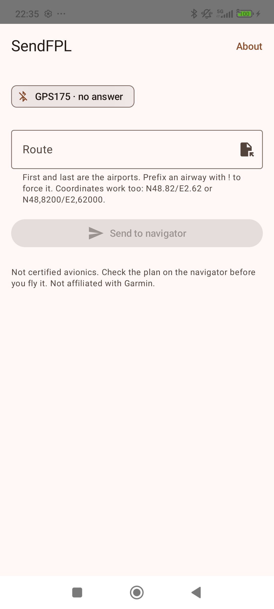

# SendFPL

[](https://github.com/0intro/sendfpl/actions/workflows/ci.yml)
[](LICENSE)

SendFPL sends a flight plan from a phone to a Garmin navigator in the panel,
over Bluetooth, as Garmin's own apps do. Type a route, or open the file your
planner exported, and the navigator holds it for preview. SendFPL runs on
Android 8.0 and newer and on iOS 16 and newer, in English and French.



SendFPL is not certified avionics. The navigator holds an imported plan for
preview. Check every waypoint there before you accept it. The pilot in command
is responsible for the plan flown.

The [home page](https://0intro.github.io/sendfpl/) describes the app, and the
[privacy policy](https://0intro.github.io/sendfpl/privacy.html) lists what it
keeps.

## Navigators

SendFPL sends to the GPS 175, GNC 355, GNX 375, GTN 6xx/7xx and GTN Xi. A GTN
talks Bluetooth through its Flight Stream 210 or 510. Each model's limits come
from its own flight plan parser. A navigator names its model when it answers,
and the route is built for that model.

On the navigator, open Home > System > Connext Setup, turn Flight Plan Import
on, and open the paired devices page. Then pair the navigator in the phone's
Bluetooth settings, or with Pair a navigator in the iPhone app.

## Routes

Type a route as identifiers separated by spaces: `LFPL CLM LFFZ LFQB`. A
position works as `N48.84/E3.01`, `N4851/E00301` or `N48507E003008`, and a
user waypoint is a name and a position: `LOBEL,N48475E002522`. Write `!V334`
to force an airway and `=E9` to force a waypoint.

Open a file with the folder icon in the route box, or send it to SendFPL from
another app. SendFPL reads six formats:

| Format | Written by, among others |
|---|---|
| Garmin `.fpl` | SD-VFR, SkyDemon, Garmin Pilot, Little Navmap |
| GPX | SD-VFR, SkyDemon |
| KML | SD-VFR, Google Earth |
| `.pln` | SD-VFR, Microsoft Flight Simulator |
| `.flightplan` | SkyDemon |
| `.gfp` | SkyDemon, Garmin's GTN trainers, Little Navmap |

Another app hands SendFPL a route as a share on Android, and as a link on iOS:
`sendfpl://send?route=LFPL%20CLM%20LFQB`.

## Building

The Android app builds with a JDK 17 or newer and the Android SDK's
`platforms;android-37.0` and `build-tools;36.0.0`. Name the SDK in
`$ANDROID_HOME`, or as `sdk.dir` in `local.properties`.

```sh
./gradlew :cxp:allTests :ui:testAndroidHostTest :app:testDebugUnitTest
./gradlew :app:assembleDebug
adb install -r app/build/outputs/apk/debug/app-debug.apk
```

The iPhone app builds on a Mac with Xcode 26 and
[XcodeGen](https://github.com/yonaskolb/XcodeGen). Its Kotlin also compiles
on Linux, with `./gradlew :ui:compileKotlinIosArm64`.

```sh
cd ios && xcodegen generate && open SendFPL.xcodeproj
```

In the iPhone app, About's Try the demo navigator sends to a GPS 175 in
memory. A launch with `-demo` also brings a credential of its own, so a
simulator runs a whole transfer.

## Layout

- `cxp/`: the Connext protocol, the route parser and the file importers, in
  Kotlin Multiplatform. Its tests run on the JVM and natively.
- `ui/`: the screens both apps share, in Compose Multiplatform, and the
  iPhone app's Kotlin.
- `app/`: the Android app: the Bluetooth link, the device list, the
  credential store, and the store listing in `src/main/play`.
- `ios/`: the iPhone app's Xcode project for XcodeGen, its Swift entry point
  and its UI test.
- `www/`: the home page and the privacy policy.

The first eight commits add these a layer at a time, so `git log --reverse`
reads as a tour of the code.

## The credential

Connext authenticates every client with one secret, compiled into Garmin's
apps. Recovering it from a copy you own, to make two products work together,
is what the exception for interoperability in EU and US copyright law is for.
Redistributing it is a different act, so it stays out of this repository.

A build bundles `local/creds.json`, or the file named by
`-Psendfpl.credential` for Gradle or `SENDFPL_CREDENTIAL` for Xcode.
Otherwise the app asks for a credential, and keeps it encrypted, readable on
that device alone. A release build requires one, so that every released app
can authenticate.

## License

MIT. See [LICENSE](LICENSE).
